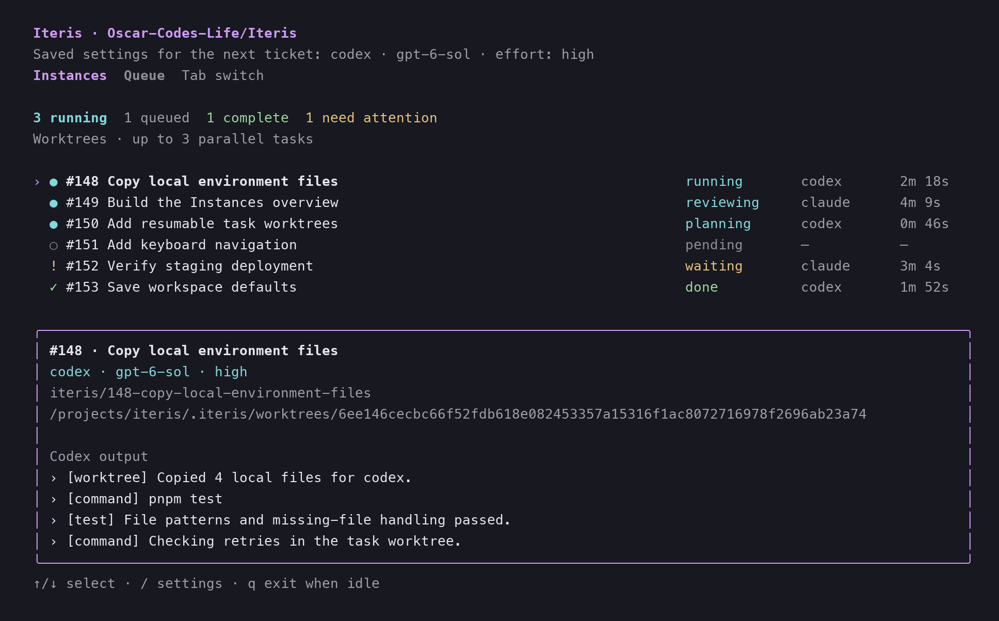

# Iteris


Iteris pulls tickets from **GitHub Issues, GitHub Projects, Trello, custom imports, or configured command adapters**, implements them with **Claude Code or Codex**, reviews the changes, and opens pull requests. It runs locally with a live terminal UI.

**v1.2.0 · Finish the backlog** — A failed attempt no longer stops a ticket. Iteris records the cause, stops the instance, keeps the work, and starts a fresh instance with that history until every ticket is done. Also includes parallel worktrees and the Instances view.

[Release notes](docs/releases/v1.2.0.md) · [Changelog](CHANGELOG.md) · [Upgrade](#upgrading) · [Release process](docs/releasing.md)



*The actual terminal component rendered with sample tasks: planning, implementation, and review running side by side.*

> Iteris uses project-local harness permissions, host-owned Git operations, and independent committed-snapshot review. Completion requires current-commit evidence; unfinished publication remains a draft. See [Configurable completion and recovery](docs/lifecycle.md).

## Installation

```bash
curl -fsSL https://raw.githubusercontent.com/Oscar-Codes-Life/Iteris/v1.2.0/install.sh | bash
```

Requires macOS/Linux, Node.js 22+, Git, and [GitHub CLI](https://cli.github.com/). The installer checks out the **v1.2.0 tag** in `~/.iteris`, builds it, and links `iteris` globally. It prefers pnpm with the committed lockfile and falls back to npm. Run `iteris --version` to check your installation.

For a user-owned installation, create a directory on your `PATH` and set `ITERIS_BIN_DIR` to it. `ITERIS_INSTALL_DIR` overrides the checkout location. The default symlink location, `/usr/local/bin`, may require sudo.

Choose either harness:

- **Codex:** install and authenticate a compatible CLI, or configure a project-local runtime/setup command. Iteris does not automatically change global installations.
- **Claude Code:** install it separately and authenticate. Iteris can launch `claude auth login` when required. It does not install or update Claude automatically.

GitHub credentials are resolved from `GH_TOKEN`, then `GITHUB_TOKEN`, then `gh auth token`. If missing, setup launches GitHub CLI browser login. Credentials stay out of `.iteris.json`; GitHub CLI manages their storage and may fall back to a plaintext user file if its credential store is unavailable. See [GitHub CLI authentication](https://cli.github.com/manual/gh_auth_login).

GitHub Projects access and repository permissions must allow reading project items/issues, writing repository content, and opening pull requests. Trello additionally requires `TRELLO_API_KEY` and `TRELLO_TOKEN`; its existing credential wizard remains available. GitHub authentication is required for every ticket source because Iteris ships PRs to GitHub.

## Quick start

```bash
cd your-repository
iteris
```

First run follows this order:

1. Choose **Claude Code** or **Codex**; wait for prerequisite checks and login.
2. Choose a model.
3. Choose a supported effort level. Models without configurable effort show **Not supported**.
4. Choose the default workspace: **Worktree** for parallel tasks or **Local** for one task at a time. Worktree mode also asks for the parallel task limit.
5. Authenticate with GitHub, if needed.
6. Choose GitHub, Trello, or a Custom REST endpoint, then the project, board/list, or endpoint settings as needed. If no GitHub Projects are visible, Iteris shows open repository issues instead.
7. Select tickets and watch the active ticket, phase, harness, model, effort, and logs.

Subsequent launches reuse project settings and proceed to ticket selection after prerequisite checks. To revisit your harness, model, effort, or ticket source, run `iteris setup`; it repeats setup, checks authentication, and exits without running tickets. Project/board and ticket selection happen when you next run `iteris`.

Missing or incompatible harnesses produce actionable setup information. Configure project-local prerequisites or select another compatible harness; Iteris does not automatically install or update global tools.

## Upgrading

Let active queues finish before updating. Install the current tagged release with the [installation command](#installation), or use the installer on `master` to select the latest version recorded there:

```bash
curl -fsSL https://raw.githubusercontent.com/Oscar-Codes-Life/Iteris/master/install.sh | bash
iteris --version
```

The installer preserves local source edits by refusing to overwrite them. Project settings, task history, and worktrees live in your project and remain in place. Configuration format stays at version 3.

**Upgrading to 1.2.0.** Failed tickets now retry with fresh instances until they finish instead of stopping or asking Retry/Skip. Tickets that an earlier version left blocked are picked up again on the next queue or `iteris resume`. No configuration change is required. To cap retries, set `recovery.maxTaskAttempts`; see [Failed attempts](#failed-attempts-journal-kill-respawn). Before running an earlier version again, remove `recovery.maxTaskAttempts` and `recovery.idleTimeout` from `.iteris.json`.

Existing projects continue in local mode until you opt in to parallel worktrees:

```bash
cd your-repository
iteris workspace worktree
iteris parallel 3
iteris
```

Use `iteris workspace local` to make future queues serial again. Already-started tasks keep their original checkout. Worktrees are retained after completion; see [Parallel worktrees](#parallel-worktrees) for environment-file copying and cleanup.

## Command reference

Run these from the root of the target Git repository. Iteris reads `.iteris.json` from the current directory and creates it on first run.

| Command | What it does |
| --- | --- |
| `iteris` | Resume unfinished work or select tasks, then watch persisted dependencies in the foreground. |
| `iteris --once` | Perform one scheduling pass without watching. |
| `iteris resume --once` | Refresh dependencies and reconcile unfinished tasks, including blocked work. |
| `iteris status`, `iteris doctor` | Inspect requirements/provenance or project prerequisites. |
| `iteris evidence <key> <receipt.json>`, `iteris cancel <key>` | Submit external evidence or cancel persisted work. |
| `iteris describe [key] [--dry-run]` | Rewrite the description, review and completion parts of published pull requests from the final diff and the saved run. |
| `iteris setup` | Reconfigure the harness, model, effort, authentication, and ticket source without running tickets. |
| `iteris harness [claude\|codex]` | Switch harness; omit the argument for a picker. |
| `iteris model [model-id]` | Switch model; omit the argument for a picker. |
| `iteris effort [level]` | Switch reasoning effort; omit the argument for a picker. |
| `iteris workspace [local\|worktree]` | Save the default workspace for future queues; omit the argument for a picker. |
| `iteris parallel [1-8]` | Save the maximum parallel worktree tasks (default: 3). Local tasks remain serial. |
| `iteris instances` | Open a live project-wide instance monitor in another terminal. |
| `iteris refresh` | Fetch and reconvert tasks from a **Custom REST endpoint**, then open the ticket picker. Other ticket sources fetch normally. |
| `iteris review [standard\|deep\|audit]` | Review the current branch and run configured checks without implementation, pushing, or opening a PR. Omit the mode to use the configured review mode. |
| `iteris --help` | Print the command synopsis. `-h` also works. |
| `iteris --version` | Print the installed release version without loading project settings. `-V` also works. |

For standalone review, `standard` uses the normal review pass, `deep` always includes a risk specialist, and `audit` adds structural proposals. Blocked or incomplete reviews exit with status 1; see [Code review](#code-review).

The `harness`, `model`, and `effort` commands save settings and exit without running tickets. In the live UI, use `/harness`, `/model`, or `/effort` with the same optional argument. Type `/` to enter a command, Enter to submit, or Escape to cancel. Changes made during a queue apply to the **next ticket**.

Common examples:

```bash
iteris setup                 # Reconfigure everything
iteris harness codex         # Use Codex for upcoming tickets
iteris model gpt-6-sol       # Select GPT-6 Sol when available to your account
iteris effort medium         # Set its reasoning effort
iteris review deep           # Inspect the current branch without shipping it
```

Each harness remembers its own model and effort. Model changes retain compatible effort settings; otherwise they use the selected model's advertised default. Codex models and effort identifiers come from the installed CLI's paginated `model/list` catalog, not a fixed OpenAI API list. Claude's model capability catalog follows [Anthropic's model configuration documentation](https://code.claude.com/docs/en/model-config).

For [GPT-6 Sol](https://developers.openai.com/api/docs/models/gpt-6-sol), use the `gpt-6-sol` model ID shown above. Iteris selects the model's advertised default effort unless your current effort is also supported. New Codex models appear as they become available in the installed CLI's catalog for your account.

Changes are saved immediately and apply to the **next ticket**. An active ticket uses the same selection through planning, implementation, review, PR description, summary, and retries. A switch to a missing Codex installation is saved for setup at the next ticket boundary. External harness/model/effort commands also defer installation and updates while a queue is running in the same repository. Externally edited execution settings are read at each boundary; invalid settings pause the queue. Correct the JSON and retry, or cancel the queue and use the terminal commands to repair selections.

### Parallel worktrees

```sh
iteris workspace worktree    # Save worktrees as this project's default
iteris parallel 3            # Run up to three tasks at once
iteris                      # Select tickets and open the Instances view
iteris instances            # Monitor the same project from another terminal
```

Each task gets its own branch and checkout under `.iteris/worktrees/<task-key>`. Iteris leaves the main checkout alone, keeps task state and logs centrally under `.iteris/tasks`, and reuses the same worktree for retries, cancellation recovery, and `iteris resume`. Existing configurations default to `local`; choose **Worktree** in `iteris setup` or use the command above. The settings are `"workspace": {"mode": "worktree", "concurrency": 3}` in `.iteris.json`.

Both [Codex](https://learn.chatgpt.com/docs/environments/git-worktrees#copy-ignored-local-files-into-managed-worktrees) and [Claude Code](https://code.claude.com/docs/en/worktrees#copy-gitignored-files-into-worktrees) currently use a root `.worktreeinclude` file. Iteris reads it for either harness and copies matching **Git-ignored files** into the task checkout before starting. The file supports Git-ignore patterns, comments, directories, and negations:

```gitignore
# Local files needed by every task
.env
.env.*
config/local/
!.env.backup
```

Missing files or a missing include file do not stop the task. Iteris copies the files it can, preserves permissions, and skips symlinks and existing destination files, so retries preserve worktree-local changes. Tracked files come from Git. Git metadata and Iteris's own state are excluded. Codex also receives an ignored `AGENTS.override.md` when present. Copy counts and skipped paths are reported without file contents. Dependencies still need to be included or installed through your configured project setup.

The **Instances** view shows concurrent activity, queued tasks, completion, and tasks needing attention. Use ↑/↓ or `j`/`k` to focus a task and see its harness, branch, checkout path, elapsed time, PR, and output. **Tab** switches between Instances and Queue. `iteris instances` refreshes the same persisted state without starting work; `q` closes only that monitor.

Live `/workspace` and `/parallel` commands save defaults for the next queue. An already-started task keeps its checkout even if the default changes. Worktrees are retained after completion so local files and changes remain available; inspect them with `git worktree list` and remove them with Git when no longer needed. One scheduler owns the project at a time, and runs the configured number of isolated tasks within that queue.

### Terminal controls

| Screen | Keys |
| --- | --- |
| Ticket picker | ↑/↓ or `j`/`k` to move, Space to toggle one ticket, `a` to select or clear all, Enter to start the selected tickets. |
| Ticket source, Project, board, and list pickers | ↑/↓ or `j`/`k` to move, Enter to select. |
| Harness, model, and effort dialogs | ↑/↓ to move, Enter to confirm, Escape or `q` to cancel. |
| Running queue | Tab switches Queue/Instances; ↑/↓ focuses an instance; `/` enters a harness/model/effort/workspace/parallel command; `q` exits after the queue finishes. Failed attempts never wait for input: the ticket shows **retrying** with the recorded cause and when a fresh instance starts. |

## Configuration and migration

Iteris creates `.iteris.json` in the project root, inferring `repo` from a GitHub Git remote when possible:

```json
{
  "version": 3,
  "harness": "claude",
  "setupComplete": false,
  "harnesses": {
    "claude": {
      "model": "opus",
      "effort": "xhigh",
      "flags": []
    },
    "codex": {
      "flags": []
    }
  },
  "repo": "org/repo-name",
  "provider": "github",
  "todoStatus": "Todo",
  "baseBranch": "main",
  "timeout": 7200,
  "planMode": true,
  "workspace": {"mode": "local", "concurrency": 3},
  "qualityChecks": ["npm run typecheck", "npm test"],
  "review": {"mode": "standard", "maxRepairCycles": 2, "allowNoChecks": false},
  "pr": {"draft": false, "addLabelOnOpen": "in-review"}
}
```

The most useful settings to edit directly are:

| `.iteris.json` key | Use |
| --- | --- |
| `workspace.mode`, `workspace.concurrency` | `local` (default) or `worktree`; maximum parallel worktree tasks, 1–8 (default 3). |
| `repo`, `baseBranch` | GitHub `owner/repo` and the branch used as the review/PR base. Iteris tries to detect both from Git. |
| `provider` | `github`, `trello`, `custom`, or `command`. Run `iteris setup` to change sources through the wizard. |
| `githubSource` | `auto` (discover Projects, fall back to issues), `issues`, or `projects`. |
| `projectNumber`, `todoStatus` | Select a GitHub Project and the status of items to show. Ignored for plain issues. |
| `trello.boardId`, `trello.listId`, `trello.moveOnComplete` | Select a board/list and optionally move completed cards to a named list. |
| `planMode` | `true` plans before implementation; `false` starts implementation directly. |
| `qualityChecks` | Shell commands that must pass on the reviewed commit, such as `npm run typecheck` and `npm test`. |
| `review.mode`, `review.maxRepairCycles`, `review.timeout`, `review.allowNoChecks` | Set review depth, attempts per recurring issue, per-stage timeout, and the explicit no-checks exception. |
| `pr.draft`, `pr.addLabelOnOpen` | Open a draft PR and, for GitHub tickets, optionally add a label after opening it. |
| `timeout` | Local execution allowance per attempt in seconds; defaults to 7200, with 20% reserved for final verification. |
| `recovery.idleTimeout` | Seconds without harness output before an instance is killed as stalled and retried; defaults to 1800, `0` disables. |
| `recovery.maxTaskAttempts` | Failed attempts after which a ticket stops; defaults to `0`, which never gives up. |
| `recovery.attempts` | Immediate repairs within one attempt before the ticket is rescheduled; defaults to 2. |

### Choose or change a ticket source

- **GitHub Issues:** set `"provider": "github"` and `"githubSource": "issues"` to show all open repository issues without Project discovery or the `read:project` scope. Pull requests are excluded; issues appear by `p0`, `p1`, `p2`, then oldest first. `projectNumber` and `todoStatus` do not filter this view.
- **GitHub Projects:** set `"provider": "github"` and `"githubSource": "projects"`. Set `projectNumber` to use a specific Project, or remove it to discover Projects on the next run. With multiple visible Projects, Iteris opens a picker; with one, it selects it automatically. `todoStatus` filters Project items.
- **Automatic GitHub source:** `"githubSource": "auto"` uses a configured or discovered Project, then falls back to issues if none are visible. Both `auto` and `projects` save `"githubSource": "issues"` on this fallback, so later runs skip Project discovery. Project lookup and authentication errors are reported rather than treated as an empty Project list.
- **Trello:** choose it with `iteris setup`. To pick a different board later, remove both `trello.boardId` and `trello.listId` from `.iteris.json`; to change lists on the same board, remove only `trello.listId`. The next run asks when multiple choices are available. Set `trello.moveOnComplete` to the name of a destination list if you want completed cards moved.
- **Custom REST:** choose it with `iteris setup`; see [Custom REST endpoints](#custom-rest-endpoints). Use `iteris refresh` to fetch updated items.

Legacy configurations migrate automatically on load:

- Save an unchanged backup at `.iteris.json.v1.bak` without overwriting an existing backup.
- Set version 3; preserve version-2 selections and move legacy `claudeFlags` into `harnesses.claude.flags`. Version-2 files receive an unchanged `.v2.bak` backup.
- Preserve repository, ticket-source, quality-check, PR, and unknown settings. Previously inherited model/effort remain unset until setup.
- Run the new setup once. Validate before atomically replacing the original file.

Invalid JSON, unsupported future versions, and conflicting custom flags produce errors without overwriting the configuration. Use the structured model/effort fields instead of flags that override Iteris's selection, transport, or phase permissions. To undo migration, restore the backup and use an older Iteris version.

`planMode: true` means plan, then implement automatically. Planning saves a verification pack and a read-only implementation plan. The host commits changes and independently reviews each resulting commit. Recovery has a shared bounded budget and reserves final verification time within `timeout`. External acceptance stages continue through persisted waiting states. See [the lifecycle guide](docs/lifecycle.md) for configuration, adapters, migration and commands.

## Custom REST endpoints

Run `iteris setup`, choose **Custom REST endpoint**, and enter the endpoint URL and the **name** of your API-key environment variable. Export the value in your shell before running Iteris:

```sh
export CUSTOM_API_KEY='your-api-key'
iteris
```

The provider settings in `.iteris.json` look like this (alongside your existing repository and harness settings):

```json
{
  "provider": "custom",
  "custom": {
    "endpoint": "https://api.example.com/tasks",
    "apiKeyEnv": "CUSTOM_API_KEY",
    "itemsPath": "data.tasks",
    "idPath": "ticket.id"
  }
}
```

`itemsPath` is a dot-separated path to the response array; omit it or use `""` when the response itself is an array. `idPath` is optional: without it, Iteris checks each item's top-level `id`, then `key`. During setup, enter `-` to clear a previously saved path.

On the first run, Iteris makes one GET request with `Authorization: Bearer <environment value>`. Later runs validate and reuse the downloaded tasks and attachments, without requesting the endpoint or running conversion again. Run `iteris refresh` to fetch and convert the latest tasks. A changed endpoint or mapping starts a new import. Downloads created by older Iteris versions require a one-time confirmation before reuse because their manifests do not identify the source endpoint.

The endpoint must return all items in one JSON response; pagination and endpoint redirects are not supported. The request timeout is 30 seconds and the response limit is 10 MiB. Credentials are not stored in configuration or passed to the conversion harness. Reusing downloaded tasks does not require the REST API key.

Each item is converted using your selected Claude Code or Codex model and effort, independently of the execution `planMode` setting. Both conversion stages use Zod validation and retry invalid output once. Conversion uses the configured phase timeout. Text, Markdown, JSON, CSV, PNG, JPEG, and WebP attachments are downloaded and analyzed. Other formats and failed downloads are listed with warnings. Downloads are limited to 10 MiB and 30 seconds per attachment, and 100 MiB per import. The Bearer token is sent only to the endpoint's origin; other attachment origins must accept public or signed URLs.

Successful imports produce a directory such as:

```text
.tasks/2026-09-09T14-30-45.123+0300/
  task1.md
  task2.md
  manifest.json
  attachments/
```

Iteris prints that location, then opens the normal task picker. Nothing is published until every task validates. Generated files are locally excluded from Git through its `info/exclude` file. When a REST item includes an `identifier` (for example, `ABC-123`), its PR title uses `ABC-123: Task title` and its branch looks like `iteris/abc-123-7cb305d7b99f29ab`. The identity suffix is stable for the source task, and Iteris saves the branch so edits and retries keep it. Items without an identifier use a shortened task title in the branch. The identifier is preserved in downloaded tasks; run `iteris refresh` to pick it up for older downloads. Items without an identifier keep the task title as their PR title. Saved imports and queues from older Iteris versions retain their original branch names.

GitHub authentication is still required: selected custom tasks use the normal branch, review, and PR workflow, without closing or labeling GitHub issues or updating the custom API.

Tasks with IDs retain their local number, branch, and execution history when edited. Numeric `123` and string `"123"` are the same ID. Tasks without IDs use a fingerprint of their source JSON; object-key order does not matter, but content edits create a new task. Mixed responses with and without IDs are supported. Identical duplicates are collapsed; conflicting records with the same ID reject the import. An item that later gains an ID becomes a new identity.

Unchanged completed tasks are unchecked by default. After a refresh, edited tasks with stable IDs show **Changed** and are checked for another run. Identity allocation and the download cache reference live in `.iteris/custom/`; execution records live in `.iteris/tasks/<stable-key>/`, with earlier task versions retained in `history/`. Keep `.iteris/` and `.tasks/` to preserve downloaded tasks, identity allocation, and completion history. If saved files are missing or invalid, Iteris asks you to run `iteris refresh` rather than silently downloading and converting everything again.

## Execution and state

Each task receives a durable record and verification pack before implementation. The host prepares the branch, the harness implements within project-local permissions, and the host commits source changes. Checks and independent reviewers assess every resulting commit. Recovery preserves local evidence and records unavailable capabilities separately.

Iteris publishes unfinished work as a draft and processes the next runnable task. A task completes only when current-commit checks, independent review, publication, required CI, explicit acceptance stages and configured source updates succeed. Waiting and retrying work resumes through the foreground worker. No background service is installed.

### Failed attempts: journal, kill, respawn

Iteris is built to finish a backlog over hours or days, so a failed attempt never abandons a ticket. When an attempt crashes, times out, stalls, fails checks or CI, or is blocked by review, Iteris:

1. records the phase, cause, commit, review findings or failed checks, and the instance's last output in `.iteris/tasks/<key>/attempts.md`;
2. stops the instance — including one that produced no output for `recovery.idleTimeout` seconds (default 1800);
3. keeps the branch, commits, plan, draft PR and evidence, committing any uncommitted partial work as a checkpoint;
4. reschedules the ticket with backoff and continues the queue;
5. starts a fresh instance whose prompt includes the ticket and the journal of earlier failures. If review blocked a commit, a repair instance fixes that commit before review runs again.

Within one attempt, up to `recovery.attempts` immediate repairs (default 2) run before the ticket is rescheduled. Fresh attempts are unlimited by default; set `recovery.maxTaskAttempts` to stop a ticket after that many failures. A stopped ticket keeps its journal and resumes with a fresh budget through `iteris resume`. Waits for external evidence and provider outages are probed with backoff and do not count. Tasks left blocked by earlier Iteris versions rejoin the loop automatically. Later attempts use the harness selection current when they start, so switching models with `/model` applies to a stuck ticket's next attempt.

State lives in `.iteris/tasks/<stable-key>/run.json`; Markdown reports are views. Keys include repository, provider, source namespace and stable source ID. Artifacts, plans, logs and review checkpoints live under the task's `artifacts/` directory. Legacy folders remain intact during migration. See [the lifecycle guide](docs/lifecycle.md) for all commands, schemas and recovery rules.

## Code review

The review outcomes are **passed**, **blocked**, and **incomplete**. A completion marker alone cannot pass review. Missing context, malformed output, omitted files or requirements, timeouts, dirty working trees, and changed commits fail closed. Critical/high findings, missing explicit requirements, verified policy violations, material structural regressions, and failing required checks block shipping. Medium/low advice remains visible without forcing unrelated rewrites. Review is automated readiness evidence; it does not approve or merge PRs.

Configure real repository commands in `qualityChecks`. An empty list produces an incomplete review and, for Node projects, suggestions from package scripts. For a change that explicitly requires no executable validation, set `review.allowNoChecks: true`; the report still says no checks ran. Existing configurations with no checks need this decision before they can ship. Commands come from configuration or the bounded recovery step; the host records their actual exit codes and outputs. A check that edits tracked source invalidates the snapshot.

Review configuration is optional and receives defaults:

```json
"review": {
  "mode": "standard",
  "maxRepairCycles": 2,
  "timeout": 900,
  "allowNoChecks": false
}
```

`deep` always adds the risk specialist. Standard mode also adds it for paths suggesting auth, credentials, migrations, shared types, subprocesses, or concurrency; this routing is a heuristic and the main pass always checks security. All required investigators run concurrently (up to three), including the risk specialist. Verification starts after they finish and has its own time allowance. Persistent blockers stop repairs early. Review and check settings edited during a queue apply at the next ticket; retries retain the active ticket settings.

Valid incomplete reviews and unverified acceptance criteria enter bounded recovery. Recovery receives unverified defect candidates, can prepare code or test-setup fixes for host commits, and can request additional local test commands. The host reruns configured checks and the independent review on a changed commit. Evidence-only recovery does not require an empty commit. A gap that only hosted CI can close is published as a draft and waits for CI. Any other gap recovery cannot resolve is preserved in the draft PR and the attempt journal, and the ticket is retried by a fresh instance while the queue continues. Schema recovery uses a separate read-only agent; a format error that survives correction is reported as incomplete without launching a project write agent or restarting the ticket indefinitely. Standalone review and audit commands still exit with status 1 for incomplete or blocked outcomes.

The queue saves its selected tickets in `.iteris/pending-queue.json`. If Iteris is interrupted, the next `iteris` invocation reclaims a dead process lock and resumes the unfinished ticket, including its saved plan, committed implementation, and review evidence. A project failure outside the review loop launches a write-capable recovery agent that receives the attempt journal. That agent must leave the ticket branch committed and clean; the normal checks and independent review still run before publication. A recovery that cannot make progress is journaled and the ticket is rescheduled for a fresh instance rather than retried in a tight loop. `iteris refresh` starts a new ticket selection.

Add `REVIEW.md` to the base branch for domain invariants and path-specific review expectations. Review uses that base version supplied inline as `context.policy`, so a branch cannot weaken its own policy. An absent base policy is allowed and is not itself an incomplete review. A finding must cite the applicable rule. File length is an investigation signal, not an automatic blocker. Reviews see the full ticket and relevant plan, inspect committed files and callers, and must justify findings through concrete causal evidence. The verifier can confirm findings, reject false positives, or mark a finding as a duplicate of one confirmed canonical finding; it must explicitly verify that previous blockers were fixed.

To review an existing branch without implementation, automatic repairs, pushing, or PR creation:

```bash
iteris review
iteris review deep
iteris review audit
```

These commands run configured checks and save results under `.iteris/reviews/`. Audit forces deep inspection and reports structural proposals. They exit with status 1 for blocked/incomplete review. They use your configured base branch and provider model, but require no GitHub authentication step. They have no linked ticket, so the report evaluates the branch's behavior and compatibility rather than claiming external ticket acceptance.

Reviewers inspect disposable detached copies. Claude receives only read/search tools, no MCP servers, and a per-run hook-disable setting; administrator-managed hooks remain subject to the CLI's managed policy. Codex uses its read-only sandbox. These are harness restrictions, not an OS isolation guarantee for arbitrary project tooling. Reproduction evidence comes from configured commands, additional local commands requested by recovery, and code tracing. Model-suggested recovery commands use local isolation and the same deadline. Configured commands use explicitly trusted host configuration. Keep autonomous implementation, repair, and quality commands in an appropriate environment.

Unexpected edits are preserved and stop review. Diffs above 240,000 characters are supplied to reviewers as complete, ordered patch parts in the disposable snapshot; a missing part makes the review incomplete. If the remote base advances before publication finishes, fetch it and retry so the review uses the new base. Review artifacts are local and are not committed; the useful summary is embedded in the PR body.

## Review evaluation

The deterministic tests cover the gate and process lifecycle; they do not measure model accuracy. A separate [30-case synthetic corpus](eval/review/README.md) contains seeded defects, clean controls, acceptance gaps, and structural regressions. Run it explicitly using your local provider and human-adjudicate findings before claiming precision or recall improvements:

```bash
npm run eval:review -- --case zero-default --harness codex
```

## Troubleshooting

| If you see… | Try… |
| --- | --- |
| A new Codex model is missing from the picker | Update the CLI manually or through configured project-local setup, then try `iteris model` again. Model availability still depends on your account's catalog. |
| `No qualityChecks configured` | Add real commands to `qualityChecks`, or set `review.allowNoChecks` to `true` only when the change needs no executable validation. |
| Custom tasks look stale or downloaded files are invalid | Run `iteris refresh` to fetch and convert them again. |
| A queue reports an active or stale lock | Confirm the previous Iteris process has stopped, then remove `.iteris/active.json` if the lock is stale. |
| A ticket keeps retrying | Read `.iteris/tasks/<key>/attempts.md` (the key is shown by `iteris status`) for every failed attempt's cause and last output. Fix a shared prerequisite, switch `/model`, or cancel with `iteris cancel <key>`. |
| A ticket is blocked | It reached `recovery.maxTaskAttempts` or recovery is disabled. Read its `attempts.md`, then run `iteris resume` to grant a fresh attempt budget. |

Follow [Upgrading](#upgrading) to update Iteris itself. `iteris setup` checks harness prerequisites and authentication; it does not update global tools.

## Development

TypeScript, Node.js 22+, React/Ink, Octokit, and Zod. Package manager: pnpm (npm also works).

```bash
npm run build
npm run typecheck
npm test
npm run test:soak
```

Tests build the application and use isolated fake CLI executables for discovery, update/login behavior, subprocess failures, configuration migration, setup, switching, and complete ticket lifecycles. They do not need real model calls or create real PRs.

`npm run test:soak` runs a 20-ticket backlog through the real runner and worker with deterministic chaos: crashed, stalled and rate-limited instances, crashes that leave uncommitted work, implementations that review blocks, crashing recovery instances, and failed CI. It passes only when the backlog drains to zero with every ticket verified complete, one PR per ticket, and fresh instances receiving the attempt journal. It runs separately from `npm test` so its load cannot skew timing-sensitive tests.

Releases use semantic versions and annotated `vX.Y.Z` tags. CI validates Linux/macOS builds and the release workflow prepares a **draft GitHub release** with a package and SHA-256 checksum. See [the release checklist](docs/releasing.md).

## Uninstall

```bash
curl -fsSL https://raw.githubusercontent.com/Oscar-Codes-Life/Iteris/v1.2.0/install.sh | bash -s -- --uninstall
```

## License

[MIT](LICENSE) © 2026 Oscar Gallo
