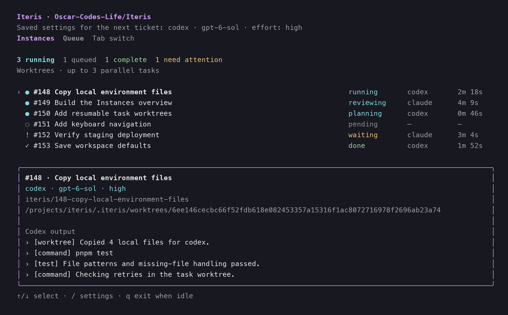

# Iteris 1.1.0 — Parallel worktrees

Iteris can now work on several tickets at once. Each task gets its own branch and Git worktree, while the new Instances view brings their progress into one terminal.

## What's new

- **Run tasks in parallel.** Choose Worktree during setup or run `iteris workspace worktree`. Set the limit with `iteris parallel 3`, from one to eight concurrent tasks.
- **Bring your local environment along.** Iteris reads the root `.worktreeinclude` used by both Claude Code and Codex, then copies matching Git-ignored files into each checkout. Missing files are skipped; existing destination files are preserved.
- **See every instance.** Track planning, implementation, review, waiting, and completed work. Focus any task to inspect its harness, branch, checkout path, elapsed time, PR, and output. Tab switches between Instances and Queue; `iteris instances` opens a separate monitor.
- **Resume where you left off.** Task checkouts persist across retries and queue restarts. State and logs stay together in the project root.



*Rendered from the actual terminal component with sample task data.*

## Install or upgrade

Let active queues finish, then run:

```bash
curl -fsSL https://raw.githubusercontent.com/Oscar-Codes-Life/Iteris/v1.1.0/install.sh | bash
iteris --version
```

Expected version: `1.1.0`. Requires macOS/Linux, Node.js 22+, Git, GitHub CLI, and an authenticated Claude Code or Codex installation (or configured project-local prerequisites).

Enable the new workflow in your project:

```bash
cd your-repository
iteris workspace worktree
iteris parallel 3
iteris
```

Add local files to `.worktreeinclude` as needed:

```gitignore
.env
.env.*
config/local/
!.env.backup
```

Only matching Git-ignored files are copied. Tracked files come from Git. Symlinks and protected Git/Iteris state are skipped; file contents are never printed in copy reports.

## Compatibility and operating notes

- Existing projects keep serial local execution. There is no required configuration migration; the configuration format remains version 3.
- New worktrees start from the configured base branch, not uncommitted changes in your main checkout.
- Worktrees live under `.iteris/worktrees/<task-key>` and remain after completion. Inspect them with `git worktree list`; remove finished checkouts with Git when no longer needed.
- Each worktree needs its own dependencies or configured setup. Shared resources such as databases and service ports are not isolated by Git; configure distinct resources where your tasks require them.
- One scheduler owns a project queue. A separate Instances monitor observes it without starting another queue; `q` closes only that monitor.
- `iteris workspace local` restores serial execution for future queues. Already-started tasks retain their checkout.

This is the first formal tagged release. Version 1.1.0 reflects an additive, opt-in upgrade from the previous 1.0.0 package baseline.

See the [full changelog](https://github.com/Oscar-Codes-Life/Iteris/blob/v1.1.0/CHANGELOG.md) and [worktree guide](https://github.com/Oscar-Codes-Life/Iteris/blob/v1.1.0/README.md#parallel-worktrees).
